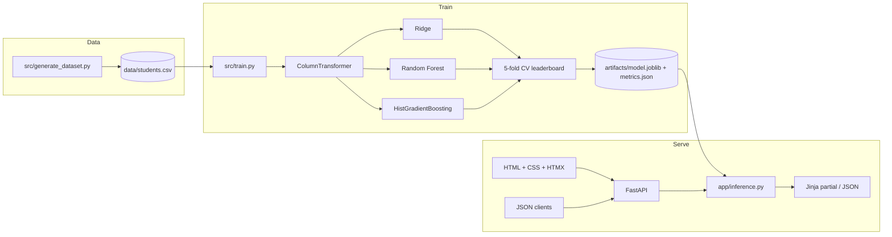

# ScholarSight

End-to-end **student performance prediction** system: a scikit-learn training pipeline, a FastAPI inference service, and a server-rendered HTML/CSS interface. Built as a portfolio project you can run locally, explain in interviews, and put on a resume.

**Stack:** Python 3.12 · FastAPI · Pydantic v2 · Jinja2 · HTMX · scikit-learn (`Pipeline` + `ColumnTransformer` + `HistGradientBoostingRegressor`) · joblib · pandas

## What it does

Given a student’s study hours, attendance, prior score, sleep, support, and a few lifestyle fields, ScholarSight predicts an exam score (0–100), assigns a risk band, reports a residual-based 90% interval, and returns concrete next actions.

It also exposes a JSON API (`POST /api/v1/predict`) so the same model can power other clients.

## Architecture



### Training path

1. `src/generate_dataset.py` writes a **reproducible synthetic cohort** (default 2,800 rows). The generator is license-clean and encodes known education signals (prior achievement, study time, attendance, sleep, tutoring, parental support) plus noise.
2. `src/train.py` fits a single sklearn `Pipeline`:
   - numeric: median impute → `StandardScaler`
   - categorical: most-frequent impute → `OneHotEncoder(handle_unknown="ignore")`
3. Three estimators are compared with 5-fold CV R² on an 80/20 split. The winner is serialized with **joblib** so inference cannot drift from training transforms.

### Inference path

1. FastAPI loads the pipeline **once** (cached).
2. HTML forms POST to `/predict` via HTMX; JSON clients POST to `/api/v1/predict`.
3. Pydantic validates ranges and enums before prediction.
4. `app/inference.py` clips the score to 0–100, maps a band, builds a 90% interval from holdout residual σ, and attaches rule-based recommendations.

```
Browser  ──HTMX POST /predict──►  FastAPI  ──DataFrame──►  sklearn Pipeline
   ▲                                  │
   └──── Jinja result partial ────────┘

Any client ──JSON POST /api/v1/predict──► same pipeline
```

## Project layout

```
student-performance-prediction/
├── app/
│   ├── main.py              # routes: pages, HTMX predict, JSON API
│   ├── inference.py         # load model, score, recommend
│   ├── schemas.py           # Pydantic v2 contracts
│   ├── templates/           # HTML (Jinja)
│   └── static/css/          # styles
├── src/
│   ├── features.py          # shared feature contract
│   ├── generate_dataset.py
│   └── train.py
├── data/students.csv        # created by the generator
├── artifacts/               # model.joblib + metrics.json
├── tests/
├── Dockerfile
├── LICENSE                  # MIT
└── README.md
```

## Quick start

```bash
python -m venv .venv
# Windows
.venv\Scripts\activate
# macOS / Linux
source .venv/bin/activate

pip install -r requirements.txt
python -m src.generate_dataset
python -m src.train
uvicorn app.main:app --reload
```

Open [http://127.0.0.1:8000](http://127.0.0.1:8000). Interactive API docs: [http://127.0.0.1:8000/docs](http://127.0.0.1:8000/docs).

```bash
pytest
```

Docker:

```bash
docker build -t scholarsight .
docker run -p 8000:8000 scholarsight
```

Train inside the image first if `artifacts/` is empty, or copy trained artifacts into the build context.

## API

| Method | Path | Purpose |
| --- | --- | --- |
| `GET` | `/` | Prediction UI |
| `GET` | `/insights` | Leaderboard and feature influence |
| `POST` | `/predict` | HTMX HTML fragment |
| `POST` | `/api/v1/predict` | JSON prediction |
| `GET` | `/api/v1/health` | Readiness |
| `GET` | `/api/v1/metrics` | Training metrics |

Example:

```bash
curl -X POST http://127.0.0.1:8000/api/v1/predict ^
  -H "Content-Type: application/json" ^
  -d "{\"hours_studied\":16,\"attendance_pct\":90,\"previous_score\":78,\"sleep_hours\":7.5,\"tutoring_sessions\":2,\"physical_activity_days\":4,\"assignments_completed_pct\":88,\"commute_minutes\":20,\"parental_involvement\":\"High\",\"internet_access\":\"Yes\",\"extracurricular\":\"Yes\",\"motivation_level\":\"High\",\"learning_style\":\"Visual\"}"
```

## Resume talking points

- Production-style **sklearn Pipeline** (no train/serve preprocessing mismatch).
- Model selection with **cross-validation**, not a single lucky split.
- FastAPI + Pydantic validation, HTML UI, and a versioned JSON API in one app.
- Cached model load, health endpoint, tests, Docker, MIT license.

## License

[MIT](LICENSE) © 2026 Ishan
